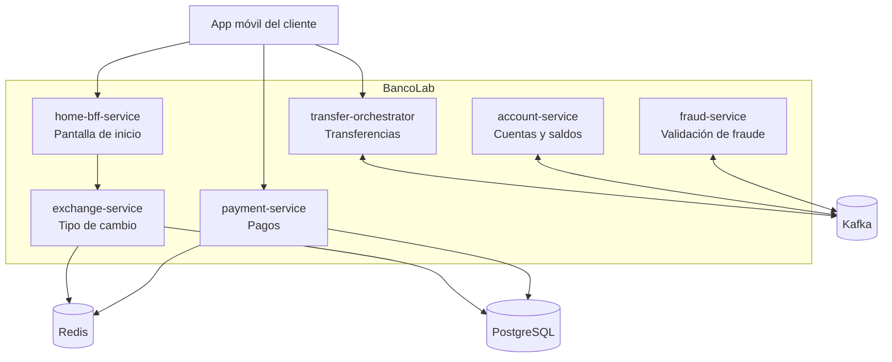

# Arquitectura general

## Diagrama

## Servicios

| Servicio | Responsabilidad | Tecnología | Estado |
|---|---|---|---|
| `exchange-service` | Calcula el tipo de cambio según el segmento del cliente | Spring WebFlux, Redis, PostgreSQL | Planificado |
| `home-bff-service` | Arma la pantalla de inicio llamando a varios servicios en paralelo | Spring WebFlux, Resilience4j | Planificado |
| `payment-service` | Procesa pagos sin cobros duplicados y controla límites diarios | Quarkus, Redis, PostgreSQL | Planificado |
| `transfer-orchestrator` | Coordina las transferencias interbancarias | Spring Boot, Kafka | Planificado |
| `account-service` | Gestiona cuentas y saldos | Spring Boot, Kafka | Planificado |
| `fraud-service` | Valida las operaciones antes de confirmarlas | Spring Boot, Kafka | Planificado |

## Infraestructura

- **Desarrollo local:** Docker Compose.
- **Nube:** Azure (AKS, ACR, Key Vault, Azure Database for PostgreSQL, Azure Cache for Redis, Event Hubs).
- **CI/CD:** GitHub Actions.